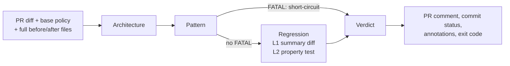

# AgentProbe

[](https://github.com/rakshithmuda22/agentprobe/actions/workflows/ci.yml)
[](pyproject.toml)
[](LICENSE)

**A GitHub Action that enforces your architecture rules on every pull request.** It blocks a PR
that crosses a module boundary, flags naming and forbidden-pattern violations inline on the
diff, and catches behavior changes, such as a function that used to raise and now returns `None`,
with a differential property test. It's deterministic: no LLM, no API keys, no per-PR cost.

## The problem

Rules like "payments must never import analytics", "the domain layer can't depend on the API
layer" or "no `eval()`" live in a wiki and get enforced by whoever happens to review the PR.
LLM code reviewers are good at spotting bugs, but they're the wrong tool for rules like these:
the same PR can get different answers on different runs, and a reviewer that misses a violation
one time in twenty isn't enforcing anything. These rules are mechanical, so AgentProbe checks
them mechanically and fails the check when they're broken.

## What it checks

Three analyzers run as nodes of a [LangGraph](https://github.com/langchain-ai/langgraph)
`StateGraph`, and a verdict node scores the results. None of them calls an LLM.

| Analyzer | What it does | How |
|---|---|---|
| **Architecture** | Module allow/deny lists and layer rules from `boundaries.yaml` | Tree-sitter extracts the imports a PR adds (Python, TS/JS, Go); relative imports are resolved against the importing file; stdlib/third-party imports never trip allow-lists |
| **Pattern** | Function/class/file naming, import order, forbidden regexes from `style-profile.yaml` | Tree-sitter over the full post-PR file, reporting only nodes on added lines (real file line numbers) |
| **Regression** | Behavior changes in functions the PR modifies | **Layer 1:** structural summary diff of whole before/after functions (signature, raise/return paths, I/O calls). **Layer 2 (opt-in):** Hypothesis runs the before *and* after version on the same generated inputs and shrinks to the smallest input where they differ |

The policy is read from the PR's **base** commit, so a PR can't loosen the rules it's judged by.
A PR that edits `.agentprobe/` is flagged for review.

## Example (real output)

This is the output of `scripts/e2e_action.py`, which builds the action's Docker image, creates a
git repo from [`examples/acme-shop`](examples/acme-shop) with three PRs, and runs the container
the way the Actions runner does, against a local stub of the GitHub API:

```
=== PR #1 1-refund-tracking (docker) ===
AgentProbe verdict: BLOCK (score 100.0/100, policy from base)
::error file=src/payments/refunds.py,line=3,title=AgentProbe::[architecture] Module 'payments' is forbidden from importing 'analytics'
::warning file=src/payments/refunds.py,line=7,title=AgentProbe::[pattern] Function 'issueRefund' is camelCase, expected snake_case
exit code: 1 | outputs: verdict=BLOCK score=100.0 | commit status: failure | OK

=== PR #2 2-lenient-charge (docker) ===
AgentProbe verdict: WARN (score 33.0/100, policy from base)
::warning file=src/payments/processor.py,line=19,title=AgentProbe::[pattern] Function 'formatReceipt' is camelCase, expected snake_case
::warning file=src/payments/processor.py,line=12,title=AgentProbe::[regression] charge: error_paths: raise PaymentError(f"invalid amount: {amount}") -> returns None
::warning file=src/payments/processor.py,line=12,title=AgentProbe::[regression] charge: Hypothesis found `charge(amount=0)`: before raised PaymentError, after returned None
exit code: 0 | outputs: verdict=WARN score=33.0 | commit status: success | OK

=== PR #3 3-currency-format (docker) ===
AgentProbe verdict: PASS (score 0.0/100, policy from base)
exit code: 0 | outputs: verdict=PASS score=0.0 | commit status: success | OK

3/3 PRs matched the expected verdict and exit code.
```

And the sticky comment it posts on PR #2:

> ## ⚠️ AgentProbe Verdict: **WARN** (score: 33.0/100)
> ### ✅ Architecture: PASS
> ### ⚠️ Pattern: WARN
> - [WARN] `src/payments/processor.py:19`: Function 'formatReceipt' is camelCase, expected snake_case
> ### ⚠️ Regression: WARN
> - [HIGH] `charge` (`src/payments/processor.py:12`) — error_paths: raise PaymentError(f"invalid amount: {amount}") → returns None
> - [HIGH] `charge` (`src/payments/processor.py:12`) — property_test: Hypothesis found `charge(amount=0)`: before raised PaymentError, after returned None
>
> *Functions compared: 1 | LLM calls: 0 | Property-test runs: 1*

## Quickstart

### 1. Add the workflow

```yaml
# .github/workflows/agentprobe.yml
name: AgentProbe
on:
  pull_request:
    types: [opened, synchronize, reopened]

permissions:
  contents: read
  pull-requests: write   # sticky PR comment
  statuses: write        # agentprobe/governance commit status

jobs:
  governance:
    runs-on: ubuntu-latest
    steps:
      - uses: actions/checkout@v4
      - uses: rakshithmuda22/agentprobe@main
        # all inputs are optional:
        # with:
        #   config_dir: .agentprobe   # where the policy files live
        #   fail_on: block            # block | warn | never
        #   post_comment: "true"      # false = annotations + job summary only
```

The step fails (exit 1) on BLOCK. To stop a BLOCK from being merged, mark the `governance` job
(or the `agentprobe/governance` status) as a **required check** in branch protection. Outputs:
`verdict`, `score`, `comment`. Findings also show up as inline annotations and in the job summary.
On fork PRs GitHub gives a read-only token. The verdict, exit code and annotations still work;
the comment and status are skipped with a warning.

### 2. Add a policy in `.agentprobe/`

`boundaries.yaml`
```yaml
modules:                        # module = first directory under src/, or set paths:
  payments:
    allowed_imports: [shared]   # first-party allow-list (stdlib/third-party always allowed)
    forbidden_imports: [analytics, requests]   # deny-list (works for third-party too)
  analytics:
    paths: [src/analytics]      # optional, e.g. for src/<package>/... layouts
layers:
  - name: presentation
    paths: [src/api, src/web]
    can_import: [domain]
  - name: domain
    paths: [src/models, src/services]
    can_import: []
```

`style-profile.yaml`
```yaml
naming:
  functions: snake_case
  classes: PascalCase
  files: snake_case             # checked for new files only
  typescript:                   # optional per-language overrides
    functions: camelCase
    files: kebab-case
imports:
  order: [builtin, external, internal, relative]   # Python, module-level imports
  max_depth: 4                  # optional: warn on deep first-party imports
forbidden:
  - console.log-in-production-code   # built-ins: this and any-type-in-typescript
  - name: no-eval
    pattern: '\beval\('
    severity: FATAL             # FATAL blocks the PR; default WARN
  - name: no-print
    pattern: '^\s*print\('
    files: "*.py"
    message: Use the logger instead of print()
```

`config.yaml` (every key optional; defaults shown)
```yaml
thresholds:
  block: 70        # weighted score above this -> BLOCK
  warn: 0          # above this -> WARN (0 = any finding is reported)
weights:
  architecture: 0.40
  pattern: 0.25
  regression: 0.35
regression:
  max_functions_per_pr: 20
  property_tests: false          # Layer 2 executes PR code; read "Security" first
  critical_dirs: [src/payments, src/auth]   # Layer 2 only runs here ([] = everywhere)
  property_test_examples: 200
  property_test_timeout_seconds: 60
llm:
  provider: none                 # "ollama" = experimental local-LLM summaries in Layer 1
ignore_paths: []                 # globs to skip, e.g. ["vendor/*", "*_pb2.py"]
```

### 3. Or run it locally, no GitHub needed

```bash
git clone https://github.com/rakshithmuda22/agentprobe.git && cd agentprobe
python3.11 -m venv .venv && source .venv/bin/activate
pip install -e ".[dev]"

python scripts/e2e_action.py --runner local   # the 3-PR demo above, without Docker
agentprobe check --repo /path/to/your/repo --base main --head HEAD   # exit 1 on BLOCK
```

## How it works



* **Inputs.** The action reads the PR diff from the GitHub API, the three policy files at the
  base SHA, and the full before/after contents of modified code files. The same pipeline backs
  the `agentprobe check` CLI (using `git`) and the optional webhook server.
* **Scoring.** Each finding is worth points by severity (FATAL 100, HIGH 40, WARN/MEDIUM 20).
  Each analyzer's points are capped at 100, then weighted 40/25/35. Any FATAL finding → BLOCK.
  Otherwise score > `block` → BLOCK, score > `warn` → WARN, else PASS. Many small issues can add
  up to a BLOCK; a single issue is never silently scored as PASS.
* **Short-circuit.** After a FATAL boundary violation, the regression analyzer, the slowest
  step, is skipped. The pattern analyzer still runs, so the author sees every style issue in
  one pass.

## Security

* **Layer 2 executes PR code**, which is why it's off by default. When it's enabled, the code
  runs in a separate `python -I` process. That process keeps only top-level imports, defs,
  classes and assignments (calls and `__main__` blocks are dropped), and it gets a scrubbed environment (no
  `GITHUB_TOKEN`), CPU/memory/file-size and wall-clock limits, a temporary working directory
  and, inside the action container, the unprivileged `nobody` uid. That makes it hard for PR code
  to read the parent process's token (verified in the container: `/proc/1/environ` gives
  `PermissionError`), but it is **not a sandbox**: the code still has network access. Enable it
  only on `pull_request` workflows, the same trust level as running the repo's tests. AgentProbe
  refuses to run it under `pull_request_target`/`workflow_run` and in webhook mode.
* The policy comes from the base commit, so a PR can't disable its own checks.
* The webhook server requires an `X-Hub-Signature-256` HMAC-SHA256 on every request (constant-time
  compare) and rejects everything if `GITHUB_WEBHOOK_SECRET` is unset.
* Size limits: 1 MB diff, 50 KB per function, 500 KB per module sent to Layer 2. Function names
  are validated before they reach the harness.

## Self-hosted webhook server (optional)

```bash
GITHUB_TOKEN=... GITHUB_WEBHOOK_SECRET=... docker compose up --build   # serves :8000/webhook
```

It uses the same pipeline and reads the policy from the base SHA over the API. It never runs
Layer 2. It authenticates with a token, not as a GitHub App.

## Tests and CI

* `pytest`: **149 tests** (Python 3.11 and 3.12). They cover the analyzers, false-positive
  regressions, scoring, the property-test harness (including that the child can't see
  `GITHUB_TOKEN`), the action entrypoint (inputs, outputs, annotations, fork-PR permission
  failures), the CLI against real temporary git repos, the GitHub client, and webhook HMAC
  verification.
* The `action-e2e` CI job builds the Docker image and runs the three sample PRs through it.
* AgentProbe governs its own PRs ([`.github/workflows/agentprobe.yml`](.github/workflows/agentprobe.yml),
  policy in [`.agentprobe/`](.agentprobe)): analyzers may not import the GitHub integration layer.

## Limitations and roadmap

* Layer 1 is a structural heuristic: it sees raise/return/print lines and signatures, not data
  flow. Layer 2 needs functions whose parameters are builtin types (int, float, str, Decimal,
  lists of them…); methods and functions taking custom classes are skipped, with the reason shown.
* Import resolution doesn't know TS path aliases (`@/x`) or Go module paths, so for those only
  relative imports and modules declared in `boundaries.yaml` are treated as first-party.
* One commit status and comment per run; GitHub Checks API annotations would be richer.
* `tree-sitter-languages` is unmaintained and has no Python 3.13 wheels. The next step is moving
  to `tree-sitter-language-pack`.
* Next: a real sandbox (gVisor/Firecracker) for Layer 2, and a benchmark of false-positive rates
  on real open-source PR history.

## Project layout

```
agentprobe/
  agents/        architecture, pattern, regression analyzers; verdict; pbt_harness (Layer 2 child)
  graph/         LangGraph state + workflow
  parsers/       tree-sitter engine, diff parser, import resolution + boundary checks
  profiles/      policy loaders, naming/forbidden-pattern rules
  integrations/  action entrypoint, shared pipeline, GitHub client, webhook server
  cli.py         `agentprobe check` / `agentprobe action`
action.yml, Dockerfile   the GitHub Action
examples/acme-shop       sample repo + 3 PRs used by scripts/e2e_action.py and CI
```

## License

MIT
